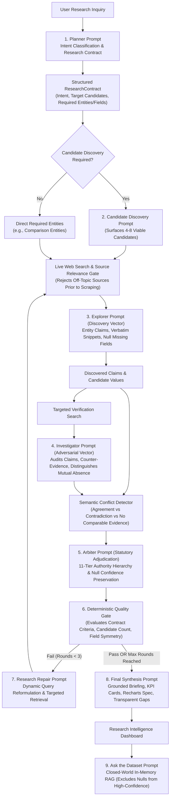

# ResearchLens AI — Prompt Engineering & Multi-Agent Architecture Specification

**Platform:** ResearchLens AI — Multi-Agent Research & Evidence Intelligence Platform  
**Developer:** Nishant Choudhary  

---

## 1. Executive Summary & Prompt Philosophy

ResearchLens AI uses an advanced modular prompt architecture to provide specialized instructions, strictly validated structured outputs, closed-world evidence-grounding constraints, and rigorous multi-agent epistemic separation. Rather than treating Generative Large Language Models as unconstrained conversational chatbots, ResearchLens AI orchestrates them as specialized, schema-bound analytical nodes within a self-correcting, multi-stage research and verification pipeline.

Every prompt across the system is engineered around foundational reliability principles:
1. **Epistemic Honesty & Null Semantics:** Absences of proof are never represented as factual strings (e.g. "Not disclosed in source", "N/A") marked as verified. Missing values are represented strictly as `null` with verification status `INSUFFICIENT_EVIDENCE` or `MISSING` and `confidenceScore: null`.
2. **Strict Schema Constraints:** Every LLM interaction is enforced by a comprehensive Zod schema, ensuring parse integrity, deterministic type guarantees, and sanitization of LLM outputs prior to pipeline ingestion.
3. **Multi-Agent Adversarial Verification:** Agents operate under a principle of least trust. The Investigator vector actively interrogates claims surfaced by the Explorer, while the Arbiter adjudicates disputes using an explicit 11-tier statutory evidence authority hierarchy.
4. **Self-Correcting Closed Feedback Loop:** When research completeness or entity coverage fails the deterministic Quality Gate, the Research Repair module dynamically reformulates search queries and initiates targeted verification rounds up to a bounded maximum.
5. **Session Isolation & Zero Contamination:** Every prompt receives context strictly scoped to the active `researchSessionId`, preventing cross-session bleed, stale query cache pollution, or historical contamination.

---

## 2. End-to-End Multi-Agent Architecture Flow



---

## 3. Detailed Prompt Specifications

---

### Prompt 1: Research Planner (`src/prompts/plannerPrompt.ts`)

- **Agent:** Research Planner Agent
- **LLM Engine:** Groq Flagship Model (`openai/gpt-oss-120b`)
- **Temperature:** `0.15` (Deterministic classification and scoping)
- **Output Schema:** `ResearchContractSchema` (Zod validated)

#### Purpose
Analyzes the user's natural-language inquiry to classify semantic intent into one of 10 canonical categories:
- `FACT_LOOKUP`
- `COMPARISON`
- `RANKING`
- `RECOMMENDATION`
- `DISCOVERY`
- `EXPLORATORY_RESEARCH`
- `FACT_CHECK`
- `CURRENT_INFORMATION`
- `POLICY_OR_REGULATORY`
- `MULTI_ENTITY_ANALYSIS`

It defines the formal `ResearchContract`, extracting required entities (for comparison or multi-entity inquiries), determining whether Candidate Discovery is required (mandatory for `RANKING`, `RECOMMENDATION`, and `DISCOVERY`), specifying target candidate counts (typically 4–8), defining required attribute fields, and generating orthogonal search strategies.

#### Inputs
- `userQuery`: The raw natural-language query entered by the user.

#### Expected Output
A strict JSON object conforming to `ResearchContract`:
```json
{
  "intent": "RANKING",
  "topic": "BTech Colleges",
  "scope": { "location": "Rajasthan, India" },
  "candidateDiscoveryRequired": true,
  "targetCandidateCount": 5,
  "requiredEntities": [],
  "requiredFields": ["NIRF_Ranking", "Accreditation", "Placement_Rate", "Average_Tuition_Fee"],
  "minimumRelevantSourcesPerEntity": 2,
  "preferredSourceTypes": ["GOVERNMENT_STATUTORY", "REGULATOR", "PRIMARY_ENTITY"],
  "freshnessRequirement": "latest available",
  "maximumResearchRounds": 3,
  "explorerFocus": ["top btech engineering colleges rajasthan nirf ranking", "best engineering institutes rajasthan list"],
  "investigatorFocus": ["aicte approved engineering colleges rajasthan official list", "nirf 2024 engineering rajasthan ranking official"]
}
```

#### Grounding & Hallucination Safeguards
- Prohibits conversational padding.
- Enforces symmetrical attribute fields for all entities in comparison tasks.
- Flags potential research risks and ambiguity upfront.

---

### Prompt 2: Candidate Discovery (`src/prompts/candidateDiscoveryPrompt.ts`)

- **Agent:** Candidate Discovery Specialist
- **LLM Engine:** Groq Flagship Model (`openai/gpt-oss-120b`)
- **Temperature:** `0.20`
- **Output Schema:** `CandidateDiscoveryOutputSchema` (Zod validated)

#### Purpose
Invoked when `candidateDiscoveryRequired: true` (e.g. for "Best BTech colleges in Rajasthan"). It ingests live web search results from candidate discovery queries, surfaces 4–8 viable, distinctive candidates, normalizes their institutional or entity names, and discards off-topic or noisy matches.

#### Inputs
- `userQuery`: Original inquiry.
- `contract`: Active `ResearchContract`.
- `searchResults`: Array of normalized web search results with titles, snippets, and domains.

#### Expected Output
```json
{
  "candidates": [
    { "name": "BITS Pilani", "normalizedName": "Birla Institute of Technology and Science, Pilani", "relevanceReason": "Premier engineering institute in Pilani, Rajasthan", "initialConfidence": 0.95 },
    { "name": "MNIT Jaipur", "normalizedName": "Malaviya National Institute of Technology Jaipur", "relevanceReason": "National Institute of Technology in Jaipur, Rajasthan", "initialConfidence": 0.92 },
    { "name": "IIT Jodhpur", "normalizedName": "Indian Institute of Technology Jodhpur", "relevanceReason": "Institute of National Importance in Jodhpur, Rajasthan", "initialConfidence": 0.92 }
  ],
  "discoveryNotes": "Discovered premier statutory engineering universities in Rajasthan from education rankings."
}
```

#### Grounding & Hallucination Safeguards
- Strictly requires candidate entities to be grounded in the supplied search snippets.
- Prevents premature commitment to a single candidate for ranking inquiries.

---

### Prompt 3: Explorer Agent (`src/prompts/explorerPrompt.ts`)

- **Agent:** Explorer Agent (Discovery Vector)
- **LLM Engine:** Groq Flagship Model (`openai/gpt-oss-120b`)
- **Temperature:** `0.20`
- **Output Schema:** `ExplorerOutputSchema` (Zod validated)

#### Purpose
Acts as the primary broad discovery vector. It ingests scraped web source snippets, extracts attribute claims for all target or candidate entities, grounds every extracted value in a verbatim supporting text snippet and authentic URL, and maps missing information to explicit `null` values with `INSUFFICIENT_EVIDENCE` status.

#### Key Directives
- **Null Semantics Mandate:** If an attribute is absent from the source, the agent must set `extractedValue: null`, `verificationStatus: "INSUFFICIENT_EVIDENCE"`, and provide an honest `missingReason`. It is strictly forbidden from writing "Not disclosed in source" or "N/A" as values.
- **Entity Symmetrical Extraction:** In comparison or multi-candidate modes, extracts identical fields across all entities to ensure fair evaluation.

---

### Prompt 4: Investigator Agent (`src/prompts/investigatorPrompt.ts`)

- **Agent:** Investigator Agent (Adversarial Verification Vector)
- **LLM Engine:** Groq Flagship Model (`openai/gpt-oss-120b`)
- **Temperature:** `0.15` (High adversarial rigor)
- **Output Schema:** `InvestigatorOutputSchema` (Zod validated)

#### Purpose
Performs independent adversarial cross-examination. It receives candidate claims surfaced by the Explorer and independently interrogates them against regulatory orders, official disclosures, and statutory archives.

#### Key Directives
- **Distinguishing Mutual Absence vs Genuine Contradiction:**
  - If Explorer reports an attribute as `null` or missing, and Investigator also finds no record, this is classified as `NO_COMPARABLE_EVIDENCE` / `AGREEMENT_ON_ABSENCE`, **never a conflict**.
  - A conflict is only declared when two substantive, contradictory factual claims exist (e.g., $94\%$ placement vs $81\%$ placement).
- **Adversarial Scrutiny:** Actively checks for outdated promotional claims, fee revisions, or unofficial directory aggregators.

---

### Prompt 5: Research Arbiter (`src/prompts/arbiterPrompt.ts`)

- **Agent:** Research Arbiter / Statutory Judge
- **LLM Engine:** Groq Flagship Model (`openai/gpt-oss-120b`)
- **Temperature:** `0.10` (Maximum deterministic precision)
- **Output Schema:** `ArbiterBatchOutputSchema` (Zod validated)

#### Purpose
Adjudicates substantive disagreements using a formal 11-tier evidence authority hierarchy:
1. `GOVERNMENT_STATUTORY` (Gov gazettes, parliamentary acts)
2. `REGULATOR` (Statutory bodies: AICTE, NIRF, RBI, SEC)
3. `PRIMARY_ENTITY` (Official university/company portals)
4. `ACADEMIC_PRIMARY` (Peer-reviewed literature, primary datasets)
5. `ACADEMIC_SECONDARY` (Systematic reviews, institutional meta-analyses)
6. `REPUTABLE_PUBLICATION` (Major journalistic newsrooms, established technical journals)
7. `INDUSTRY_SOURCE` (Industry whitepapers, audited trade reports)
8. `SECONDARY_DIRECTORY` (Third-party aggregator portals: CollegeDunia, Shiksha)
9. `AGGREGATOR` (Community forums, social reviews)
10. `REFERENCE` (General encyclopedic wikis: Wikipedia)
11. `UNKNOWN` (Unattributed or unverified domains)

#### Key Directives
- If two sources conflict, the source higher in the authority hierarchy prevails.
- When reliable evidence cannot resolve a dispute, the field is preserved as `CONFLICTING` with lowered confidence.
- Missing values receive `confidenceScore: null`.

---

### Prompt 6: Quality Gate Evaluation (`src/services/orchestrator.ts`)

- **Execution:** Deterministic TypeScript validation with strict contractual criteria.
- **Criteria Evaluated:**
  1. `Required Entities Present`: All explicitly mandated entities (e.g., Python and JavaScript) must have extracted records.
  2. `Candidate Count Threshold`: Ranking queries must discover $\ge \text{targetCandidateCount}$ (or at least 3).
  3. `Field Symmetry`: Required fields must be attempted across all entities.
  4. `Source Relevance`: Accepted sources must pass the deterministic relevance gate ($\ge 0.50$ score).
  5. `Coverage Ratio`: Minimum percentage of required fields with conclusive or supported evidence.
  6. `Contamination Freedom`: Asserts zero foreign entity bleed across sessions.

---

### Prompt 7: Research Repair & Reformulation (`src/prompts/researchRepairPrompt.ts`)

- **Agent:** Research Repair Planner
- **LLM Engine:** Groq Flagship Model (`openai/gpt-oss-120b`)
- **Temperature:** `0.20`
- **Output Schema:** `ResearchRepairPlanSchema` (Zod validated)

#### Purpose
Invoked dynamically if the Quality Gate fails and research rounds remain ($< \text{MAX\_RESEARCH\_ROUNDS} = 3$). It analyzes specific failures (e.g. missing candidate entities, deficient criteria coverage) and reformulates targeted search queries to fill the specific evidence gaps.

#### Inputs
- `contract`: Original `ResearchContract`.
- `qualityGate`: Failed `QualityGateResult` with specific failure reasons.
- `existingEntities`: Currently discovered entities and missing fields.

#### Expected Output
```json
{
  "reformulatedQueries": [
    "site:nirfindia.org engineering ranking 2024 Rajasthan official PDF",
    "Malaviya National Institute of Technology Jaipur NIRF 2024 ranking"
  ],
  "targetEntitiesToRepair": ["MNIT Jaipur", "IIT Jodhpur"],
  "targetFieldsToRepair": ["NIRF_Ranking", "Accreditation"],
  "repairRationale": "Directing search to official NIRF repository for missing statutory ranking data."
}
```

---

### Prompt 8: Final Synthesis & Visualization (`src/prompts/finalSynthesisPrompt.ts`)

- **Agent:** Executive Synthesis / Visualizer
- **LLM Engine:** Groq Flagship Model (`openai/gpt-oss-120b`)
- **Temperature:** `0.20`
- **Output Schema:** `DashboardSpecSchema` (Zod validated)

#### Purpose
Synthesizes verified records into an executive briefing and dynamic dashboard specification.
- Generates 4–6 verified KPI summary cards.
- Specifies dynamic Recharts visualizations (Bar/Pie charts) derived strictly from substantiated entity properties.
- **Transparent Gap Reporting:** Dedicated section explicitly documenting which fields could *not* be verified and why.
- **Comparative Fairness:** In comparison queries, synthesizes both entities symmetrically along identical dimensions.

---

### Prompt 9: Ask the Dataset (`src/prompts/datasetPrompt.ts`)

- **Agent:** Dataset Intelligence Interpreter
- **LLM Engine:** Groq Flagship Model (`openai/gpt-oss-120b`)
- **Temperature:** `0.10` (Maximum factual boundedness)
- **Output Schema:** `AskDatasetResponseSchema` (Zod validated)

#### Purpose
Enables conversational queries strictly grounded in the active session dataset.
- **Deterministic Priority Handlers:** Programmatically handles "highest confidence" queries by filtering for substantiated claims with `confidenceScore > 0` and sorting descending. Missing/null fields are strictly excluded.
- **Insufficient Evidence Queries:** Programmatically lists fields marked `INSUFFICIENT_EVIDENCE` or `MISSING` along with their recorded failure reasons.
- **Source Inquiries:** Programmatically lists accepted sources filtered by authority type and URL.

---

## 4. Production Engineering & Architectural Safeguards

| Safeguard | Implementation & Evidence |
| :--- | :--- |
| **Strict Null Semantics** | In `src/services/schemas.ts`, `sanitizeClaimValue` automatically maps missing strings to `null` with `null` confidence. |
| **Source Relevance Gate** | In `src/services/webSearch.ts`, `validateSourceRelevance` computes keyword and domain overlap, rejecting off-topic sources before scraping. |
| **Session Isolation** | In `src/services/orchestrator.ts`, all state is scoped to `sessionId`. Web search cache keys include normalized query strings. |
| **Authority Classification** | In `src/services/scraper.ts`, 11 contextual authority tiers classify sources based on TLD, domain ownership, and publisher reputation. |
| **Quality Gate & Repair Loop** | Deterministic quality evaluation triggers up to 3 bounded self-correcting repair iterations with query reformulation. |
| **Truthful Architecture** | UI and documentation accurately describe the sequential dual-vector investigation pipeline. |
