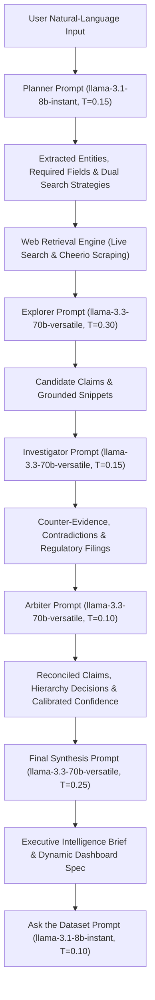

# ResearchLens AI — Prompt Engineering & Architecture Specification

**Platform:** ResearchLens AI — Multi-Agent Research & Evidence Intelligence Platform  
**Developer:** Nishant Choudhary  

---

## 1. Executive Summary & Prompt Philosophy

ResearchLens AI uses a modular prompt architecture to provide specialized instructions, structured outputs, evidence-grounding constraints, and role separation across its multi-agent pipeline. Generative Large Language Models are deployed not as free-form chatbots, but as specialized, constrained NLP processing nodes within an asynchronous multi-agent verification pipeline.

Every prompt in this system is architected around four foundational NLP engineering principles:
1. **Role Specialization & Principle of Least Trust:** Agents do not blindly trust the outputs of preceding agents. The Investigator actively seeks to refute claims discovered by the Explorer, and the Arbiter evaluates both using an explicit hierarchy of authority.
2. **Schema-Constrained Structured Output:** Every prompt enforces a strictly typed JSON schema validated via Zod, eliminating free-form conversational drift and preventing parsing crashes.
3. **Multi-Tiered Hallucination Mitigation:** Prompts explicitly forbid external assumption, require exact supporting text snippets from retrieved web pages, and demand uncertainty preservation when evidence is ambiguous.
4. **Calibrated Confidence Scoring:** Every synthesized fact carries an explicit confidence score ($0.00$ to $1.00$) calibrated against the statutory authority of the underlying source.

---

## 2. End-to-End Prompt Pipeline

---

## 3. Detailed Prompt Specifications

---

### Prompt 1: Research Planner (`src/prompts/plannerPrompt.ts`)

- **Agent:** Research Planner Agent
- **LLM Engine:** Groq `llama-3.1-8b-instant` (High throughput, deterministic structured output)
- **Temperature:** `0.15`
- **Output Schema:** `ResearchPlanSchema` (Zod validated)

#### Purpose
Analyzes the user's natural-language inquiry to perform **intent extraction**, **named entity recognition (NER)**, and **problem decomposition**. It splits the research into verifiable attribute fields and generates two independent, non-overlapping search strategies for the subsequent Explorer and Investigator agents.

#### Inputs
- `userQuery`: The raw natural-language prompt submitted by the user.
- `domainContext`: Optional geographic or institutional domain constraints.

#### Expected Output
A strict JSON object containing:
- `objective`: Formal research objective.
- `targetEntitiesDescription`: Definition of entities to be discovered.
- `geographyScope`: Spatial bounds (e.g., "Rajasthan, India" or "Global").
- `requiredFields`: Minimum of 3 specific attributes to extract per entity.
- `searchStrategies`:
  - `explorerFocus`: 3-5 concise search engine keywords for broad entity discovery.
  - `investigatorFocus`: 3-5 verification keywords targeting primary gazettes, regulatory orders, and statutory disclosures.
- `verificationRequirements`: Rules defining acceptable proof.
- `confidenceThreshold`: Numerical standard (default 0.85).

#### Architectural Rationale & Why It Is Structured This Way
Search engines degrade significantly when fed conversational questions. The Planner converts conversational English into concise, keyword-dense search phrases (3-6 words each) while formulating orthogonal search vectors: one maximizing discovery breadth and one maximizing verification rigor.

#### Hallucination Mitigation & Grounding Strategy
- Explicitly forbids verbose sentences or meta-instructions in keyword outputs.
- Forces the definition of concrete `potentialResearchRisks` before any web search commences, priming downstream agents to watch for known failure modes.

#### Error & Fallback Strategy
If parsing fails, the client uses a repair prompt enforcing pure JSON with `llama-3.1-8b-instant`.

---

### Prompt 2: Explorer Agent (`src/prompts/explorerPrompt.ts`)

- **Agent:** Explorer Agent (Discovery Vector)
- **LLM Engine:** Groq `llama-3.3-70b-versatile` (Deep comprehension and entity extraction)
- **Temperature:** `0.30`
- **Output Schema:** `ExplorerOutputSchema` (Zod validated)

#### Purpose
Acts as the broad discovery vector. It ingests unstructured HTML snippets and crawled page contents, identifies candidate entities matching the Research Plan, extracts attribute claims, and ties every extracted field to an authentic source URL and text snippet.

#### Inputs
- `plan`: The active `ResearchPlan`.
- `webSources`: Array of discovered web sources with URLs, titles, and scraped text snippets.
- `userQuery`: Original query for contextual anchoring.

#### Expected Output
A JSON object containing:
- `searchQueriesUsed`: The queries executed.
- `discoveredEntities`: Array of entity records with extracted fields, candidate values, source URLs, source titles, and supporting quotation snippets.
- `summaryOfDiscovery`: A factual summary of the landscape surfaced.

#### Hallucination Mitigation & Grounding Strategy
- **Snippet Requirement:** Every extracted value must be accompanied by a `supportingSnippet` directly quoting or closely paraphrasing the provided web source.
- **URL Provenance:** The agent is instructed to use only the URLs provided in the input context. It is strictly forbidden from generating synthetic URLs.
- **Missing Value Honesty:** If an entity lacks a required field in the retrieved text, the agent must mark it as `NOT_DISCLOSED` rather than fabricating an estimate.

---

### Prompt 3: Investigator Agent (`src/prompts/investigatorPrompt.ts`)

- **Agent:** Investigator Agent (Adversarial Verification Vector)
- **LLM Engine:** Groq `llama-3.3-70b-versatile` (Adversarial reasoning and regulatory checking)
- **Temperature:** `0.15`
- **Output Schema:** `InvestigatorOutputSchema` (Zod validated)

#### Purpose
Executes adversarial verification. It takes the candidate claims surfaced by the Explorer and independently audits them against authoritative sources (government filings, regulatory orders, corporate disclosures). It detects discrepancies, pricing shifts, and outdated marketing claims.

#### Inputs
- `plan`: Active `ResearchPlan`.
- `webSources`: Authoritative and regulatory sources retrieved via the investigator's targeted queries.
- `explorerEntities`: The complete candidate claim matrix from the Explorer Agent.

#### Expected Output
A JSON object containing:
- `counterEvidenceOrChallenges`: Discrepancies detected between Explorer's claims and primary sources, with `challengedValue`, `primaryEvidenceValue`, `primarySourceUrl`, and explicit `reasonForDoubtOrConflict`.
- `verifiedConfirmations`: Claims independently corroborated by primary documentation.
- `missingFieldsIdentified`: Mandatory fields absent from public statutory filings.

#### Hallucination Mitigation & Grounding Strategy
- **Adversarial Principle:** The prompt explicitly instructs the LLM: *"Do NOT accept Explorer claims at face value. Demand authoritative evidence."*
- **Reasoning Requirement:** Demands explicit causal explanations for conflicts (e.g., "Explorer used a 2022 marketing flyer; official 2026 Discom tariff order sets commercial rate at ₹14.50/kWh").

---

### Prompt 4: Research Arbiter / Judge (`src/prompts/arbiterPrompt.ts`)

- **Agent:** Research Arbiter Agent
- **LLM Engine:** Groq `llama-3.3-70b-versatile` (High-precision adjudication)
- **Temperature:** `0.10` (Extremely deterministic)
- **Output Schema:** `ArbiterBatchOutputSchema` (Zod validated)

#### Purpose
Reconciles disagreements between the Explorer and Investigator agents. It applies a **deterministic hierarchy of evidence authority**:
$$\text{Statutory / Government} \succ \text{Primary Entity Telemetry} \succ \text{Academic / Industry Audit} \succ \text{Journalistic Publication} \succ \text{Aggregator / Directory}$$

It resolves disputes where authoritative evidence prevails, preserves unresolved conflicts where proof is contradictory, and assigns calibrated confidence scores.

#### Inputs
- `plan`: Active `ResearchPlan`.
- `conflicts`: Array of detected claim conflicts with opposing values, source authorities, and snippets.
- `entitiesSummary`: High-level summary of candidate entities.

#### Expected Output
A JSON object containing:
- `evaluations`: Array of field-by-field verdicts:
  - `resolution`: `CONSENSUS`, `INVESTIGATOR_SELECTED`, `EXPLORER_SELECTED`, or `UNRESOLVED`.
  - `resolvedValue`: The definitive reconciled value.
  - `confidenceScore`: Calibrated probability between `0.00` and `1.00`.
  - `decisionBasis`: Rigorous rationale explaining the evidentiary justification.
  - `freshnessPreferenceApplied`: Boolean flag.
  - `primarySourcePreferenceApplied`: Boolean flag.
- `overallAssessment`: Executive evaluation of evidentiary agreement.
- `conflictsPreserved`: Detailed list of genuine disputes that cannot be statutorily resolved.

#### Hallucination Mitigation & Grounding Strategy
- **Explicit Uncertainty Preservation:** Prompts explicitly forbid forcing a consensus when evidence is conflicting. True ambiguities are preserved as `UNRESOLVED` with lowered confidence ($<0.50$).
- **Calibrated Scoring:** Requires high confidence scores ($>0.85$) to be backed by primary/official sources.

---

### Prompt 5: Final Synthesis & Visualizer (`src/prompts/finalSynthesisPrompt.ts`)

- **Agent:** Executive Synthesis / Dashboard Visualizer
- **LLM Engine:** Groq `llama-3.3-70b-versatile`
- **Temperature:** `0.25`
- **Output Schema:** `DashboardSpecSchema` (Zod validated)

#### Purpose
Synthesizes verified records into an executive briefing and dynamic dashboard specification. It computes verified KPI summaries, determines optimal chart representations for Recharts, and produces a transparent audit of what could *not* be verified.

#### Inputs
- `query`: User's original inquiry.
- `plan`: Research plan specification.
- `entities`: Array of fully verified and audited `DiscoveredEntity` records.
- `conflicts`: All reconciled and unresolved conflicts.
- `sources`: Complete list of audited web sources.

#### Expected Output
A JSON object containing:
- `headline`: Professional intelligence brief headline.
- `summary`: Synthesized briefing connecting findings to the research objective.
- `metrics`: 4-6 KPI cards with computed values, descriptions, and semantic tones.
- `charts`: Dynamic bar/pie chart specifications derived from actual entity properties.
- `tableColumns`: Optimal column schema for the evidence table.
- `unverifiedObservations`: 3-5 explicit observations detailing data gaps and unverified items.

#### Hallucination Mitigation & Grounding Strategy
- **Closed Data Constraint:** Charts and metrics must directly map to values present in `entities`. Fabricating external statistics is explicitly penalized in the prompt instructions.

---

### Prompt 6: Ask the Dataset (`src/prompts/datasetPrompt.ts`)

- **Agent:** Dataset Query Interpreter
- **LLM Engine:** Groq `llama-3.1-8b-instant` (Fast, strictly bounded retrieval Q&A)
- **Temperature:** `0.10`
- **Output Schema:** `AskDatasetResponseSchema` (Zod validated)

#### Purpose
Powers the natural-language "Ask the Dataset" interface. It enables researchers to query the in-memory verified dataset (e.g., "Which entities have the highest confidence?", "Show unresolved conflicts", "Which sources were most authoritative?").

#### Inputs
- `question`: Natural language question regarding the active dataset.
- `entities`: The complete set of verified session entity objects.

#### Expected Output
A JSON object containing:
- `answer`: Precise, factual answer citing specific entities and source links.
- `highlightEntities`: Array of entity names relevant to the answer.
- `filteredCount`: Number of matching records.
- `provenanceNote`: Evidentiary basis and source attribution.

#### Hallucination Mitigation & Grounding Strategy
- **Closed World Assumption:** The prompt explicitly states: *"Answer using ONLY the entities and fields provided in the dataset. Do not bring in facts, entities, numbers, or dates from outside the provided records, even if you know them."*
- **Transparent Refusal:** If the query asks for information not captured in the session, the prompt mandates stating: *"The current research dataset does not contain sufficient verified evidence to answer this question."*

---

## 4. Production Engineering & Architectural Safeguards

| Engineering Safeguard | Implementation & Architectural Evidence |
| :--- | :--- |
| **Code Efficiency & Modularity** | Modular prompt builders in `src/prompts/`, TypeScript interfaces, strict Zod schema validation, and zero prompt duplication across components. |
| **API Resilience & Rate Management** | Centralized in `src/services/groqClient.ts` with timeout handling (30s), exponential backoff, rate-limit resilience (429), and temperature tuning per agent role. |
| **Prompt Precision & Token Economy** | Concise, domain-grounded system prompts with explicit few-shot formats, closed-world constraints, and strict JSON output schemas. |
| **Epistemic Integrity & Verification** | Real multi-agent separation where agents cross-examine, refute, and adjudicate evidence rather than acting as a superficial wrapper. |
