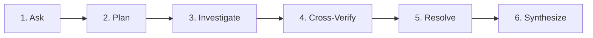
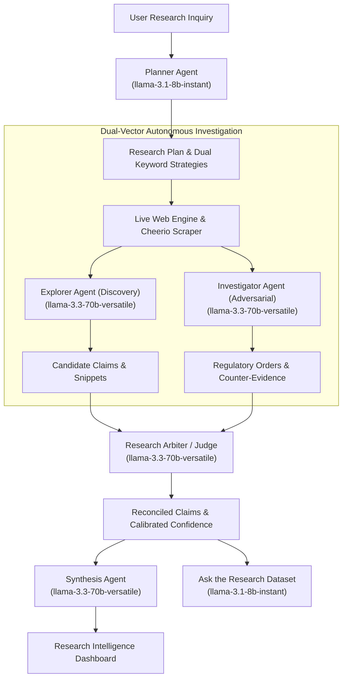
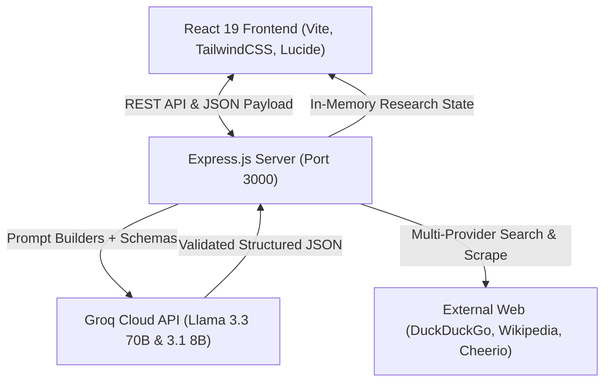

# ResearchLens AI

**Multi-Agent Research & Evidence Intelligence Platform**

Developed by **Nishant Choudhary**

---

## Overview

**ResearchLens AI** is an autonomous multi-agent research and evidence intelligence platform that transforms complex natural-language questions into structured, evidence-backed insights. Instead of relying on conversational chatbots that summarize search results without verification, ResearchLens AI deploys an adversarial multi-agent pipeline where specialized AI agents independently investigate information, cross-check findings across sources, detect contradictions, and synthesize results with transparent confidence and source attribution.

Every claim discovered by the platform is extracted as a discrete structured entity, cross-examined against authoritative records, linked to its verbatim source passage, and evaluated using an explicit hierarchy of evidentiary authority.

---

## Why ResearchLens AI?

Modern Large Language Models possess exceptional reasoning capabilities, but deploying them as simple chatbots for research introduces critical failure modes:

- **Hallucinated Citations:** Generating non-existent URLs, fictitious statistics, or fabricated dates.
- **Confirmation Bias:** Trusting the first retrieved web page without cross-checking corroborating sources.
- **Temporal Inconsistency:** Quoting outdated drafts, deprecated pricing, or expired regulatory filings as active truth.
- **Uncertainty Masking:** Expressing equal conversational confidence in verified facts and ungrounded guesses.

**ResearchLens AI** solves these challenges by treating research verification as a formal NLP problem combining **Information Extraction (IE)**, **Named Entity Recognition (NER)**, **Natural Language Inference (NLI)**, **Multi-Agent Epistemic Arbitration**, and **Closed-Domain Semantic Reasoning**.

---

## Core Capabilities

- **Autonomous Research Decomposition:** Deconstructs broad inquiries into verifiable attributes, scope constraints, and targeted search vectors.
- **Dual-Vector Investigation:** Runs two independent agents with orthogonal goals—an **Explorer Agent** optimizing for breadth and discovery, and an **Investigator Agent** optimizing for adversarial scrutiny and regulatory verification.
- **Contradiction Detection & Adjudication:** Flags numerical, temporal, and factual disagreements across sources and adjudicates them using a statutory authority hierarchy.
- **Transparent Confidence Calibration:** Calculates state-derived confidence scores ($0.00$ to $1.00$) reflecting source authority, corroboration level, and unresolved discrepancies.
- **Real State-Derived Analytics:** Generates interactive dashboards with Recharts visualizations, evidence matrices, and source intelligence based entirely on actual pipeline state.
- **Closed-World Retrieval Q&A:** "Ask the Research Dataset" allows natural-language questioning strictly grounded in verified session entities, refusing to hallucinate external facts.

---

## How It Works

The platform operates through a sequential 6-stage lifecycle:



1. **Ask:** The user inputs an unstructured natural-language inquiry with geographic, domain, or comparative requirements.
2. **Plan:** The Planner Agent extracts intent, identifies entities, defines required attributes, and formulates orthogonal search keyword strategies.
3. **Investigate:** The web engine queries search providers and scrapes authoritative pages; the Explorer Agent extracts candidate claims with citations.
4. **Cross-Verify:** The Investigator Agent audits candidate claims against primary company portals and statutory regulatory orders.
5. **Resolve:** The Arbiter Agent cross-examines findings, detects contradictions, applies the evidence hierarchy, and calibrates confidence.
6. **Synthesize:** The Synthesis Agent generates an executive briefing and dynamic dashboard specification, while the session is immediately queryable via Ask the Dataset.

---

## Multi-Agent Architecture

ResearchLens AI enforces strict role separation and a principle of least trust across four specialized agents:



### Agent Responsibilities

| Agent | Model Engine | Temperature | Primary Responsibility |
| :--- | :--- | :--- | :--- |
| **Planner Agent** | Groq `llama-3.1-8b-instant` | `0.15` | Intent classification, NER, slot definition, and dual-vector search query generation. |
| **Explorer Agent** | Groq `llama-3.3-70b-versatile` | `0.30` | Broad evidence retrieval, entity discovery, claim extraction, and source snippet mapping. |
| **Investigator Agent** | Groq `llama-3.3-70b-versatile` | `0.15` | Adversarial cross-examination, regulatory checks, and contradiction detection. |
| **Arbiter Agent** | Groq `llama-3.3-70b-versatile` | `0.10` | Evidence hierarchy adjudication, conflict resolution, and calibrated confidence scoring. |
| **Synthesis Agent** | Groq `llama-3.3-70b-versatile` | `0.25` | Multi-document summarization, executive briefing, and dynamic dashboard schema generation. |
| **Ask Dataset Agent** | Groq `llama-3.1-8b-instant` | `0.10` | Closed-world question answering strictly bounded by verified session records. |

---

## Intelligence / NLP Pipeline

ResearchLens AI implements an 11-stage NLP processing pipeline, visible interactively in the **Intelligence Pipeline** view:

1. **Natural Language Input:** Ingestion of arbitrary natural-language research questions with complex constraints.
2. **Intent Analysis & Classification:** Semantic intent categorization (comparative benchmarking, regulatory tariff auditing, directory synthesis).
3. **Named Entity Recognition (NER):** Extraction of organizations, hardware standards, and geographic scopes.
4. **Query Decomposition:** Sub-goal planning transforming conversational text into orthogonal search keyword vectors.
5. **Prompt Construction & Grounding:** Dynamic injection of scraped web passages into structured Zod JSON schemas.
6. **Multi-Agent LLM Processing:** Concurrent dual-vector execution preventing confirmation bias.
7. **Evidence Retrieval & Scraping:** Multi-provider search (DuckDuckGo, Wikipedia, Direct Web) with HTML noise stripping.
8. **Claim & Fact Extraction:** Information Extraction (IE) converting passages into structured knowledge triples.
9. **Contradiction Detection:** Natural Language Inference (NLI) detecting cross-document numerical and factual inconsistencies.
10. **Arbitration & Adjudication:** Evidentiary authority hierarchy application and confidence calibration.
11. **Final Synthesis & Grounded Q&A:** Multi-document summarization and closed-world semantic question answering.

---

## LLM Integration

ResearchLens AI connects directly to **Groq Cloud API** for ultra-fast, high-throughput inference with specialized model assignments:

- **Flagship Heavyweight Inference:** `llama-3.3-70b-versatile` powers deep reasoning, adversarial cross-examination, and complex arbitration.
- **High-Velocity Structured Output:** `llama-3.1-8b-instant` powers initial research planning and low-latency closed-world Q&A.
- **API Resilience:** Built-in timeout controls (30s), exponential backoff retry logic, rate-limit resilience (HTTP 429), and JSON code-fence sanitization.
- **Server-Side Security:** All Groq API calls execute exclusively in the Node.js backend (`src/services/groqClient.ts`). API keys are never bundled into client-side JavaScript.

---

## Prompt Architecture

All prompts are decoupled into dedicated TypeScript modules within `src/prompts/` and documented in detail in [`PROMPTS.md`](PROMPTS.md):

- `src/prompts/plannerPrompt.ts`: NER, intent extraction, search strategy generation.
- `src/prompts/explorerPrompt.ts`: Entity discovery, claim extraction, verbatim snippet quotation.
- `src/prompts/investigatorPrompt.ts`: Adversarial cross-examination, regulatory checks, conflict discovery.
- `src/prompts/arbiterPrompt.ts`: Statutory hierarchy adjudication, calibrated confidence scoring.
- `src/prompts/finalSynthesisPrompt.ts`: Executive briefing and dynamic dashboard specification.
- `src/prompts/datasetPrompt.ts`: Closed-world grounded retrieval Q&A.
- `src/prompts/index.ts`: Central registry and schema export.

---

## Evidence Verification

Every candidate claim extracted from web sources is linked to verifiable metadata:

- **Verbatim Text Snippet:** Exact excerpt extracted from the source document.
- **Direct Source URL:** Clickable, authentic web reference.
- **Source Classification:** Automatic authority categorization based on domain structure:
  - `OFFICIAL_GOV`: Regulatory portals, gazettes, statutory commissions.
  - `PRIMARY_COMPANY`: Official enterprise websites, investor relations, SEC/MCA filings.
  - `ACADEMIC_INDUSTRY`: Peer-reviewed studies, technical whitepapers, accredited indices.
  - `SECONDARY_MEDIA`: Reputable trade journals, major news publications.
  - `AGGREGATOR`: Directories, blogs, crowdsourced review portals.
  - `UNVERIFIED`: Low-authority or unattributed sources.

---

## Conflict Resolution

When the Explorer and Investigator agents discover conflicting values for the same entity attribute (e.g. ₹16.00/kWh in a 2022 blog post vs. ₹14.50/kWh in an official 2026 tariff order), the **Research Arbiter** applies a deterministic statutory hierarchy:

$$\text{Official Gov / Statutory} \succ \text{Primary Entity Portal} \succ \text{Academic / Industry Study} \succ \text{Journalistic Publication} \succ \text{Aggregator / Directory}$$

- **Resolved Conflict:** If one source holds clear statutory precedence, the conflict is resolved, the decision basis is recorded, and the higher-authority value is accepted.
- **Unresolved Conflict (Preserved Ambiguity):** If sources hold equal authority and disagree, the platform explicitly preserves the discrepancy as `UNRESOLVED` with lowered confidence, preventing the LLM from fabricating an arbitrary consensus.

---

## Ask the Research Dataset

The **Ask Research** module provides a retrieval-grounded natural-language query interface over the current session data:

- **Closed-World Constraint:** The model is strictly instructed: *"Answer using ONLY the entities and fields provided in the dataset. Do not bring in facts, numbers, or dates from outside the provided records."*
- **Transparent Refusal:** If an inquiry asks for information not present in the verified dataset, the system explicitly states that the records contain insufficient evidence.
- **Quick-Question Presets:**
  - *"Which findings have the highest confidence?"*
  - *"Show unresolved conflicts"*
  - *"Which sources were used most?"*
  - *"Summarize the verified findings"*
  - *"Which claims have insufficient evidence?"*

---

## Dashboard & Analytics

The **Evidence Intelligence Dashboard** provides real-time, state-derived analytics built with **Recharts**:

- **6 State-Derived KPI Cards:** Sources Analyzed, Verified Claims, Conflicting Claims, Average Confidence %, Entities Discovered, and Research Completion %.
- **Executive Summary:** Synthesized briefing with dynamic scope badges and structured takeaways.
- **Verification Status Distribution:** Interactive pie chart displaying Verified, Conflict, and Insufficient Evidence proportions.
- **Confidence Distribution:** Bar chart grouping findings into calibrated confidence brackets (90-100%, 75-89%, 50-74%, <50%).
- **Interactive Evidence Matrix:** Searchable, filterable table by entity, attribute, authority, and status with verbatim source snippets.
- **Dedicated Conflict Analysis:** Card-by-card breakdown of opposing claims, supporting evidence, and Arbiter decisions.

---

## System Architecture



---

## Technology Stack

- **Frontend:** React 19, TypeScript, Vite, TailwindCSS, Lucide Icons, Recharts, React Flow (`@xyflow/react`).
- **Backend:** Node.js, Express, TypeScript (`tsx`).
- **LLM Inference:** Groq Cloud SDK (`groq-sdk`), Meta Llama 3.3 70B Versatile, Meta Llama 3.1 8B Instant.
- **Schema Validation:** Zod.
- **Web Retrieval & Scraping:** Cheerio, native Fetch API, DuckDuckGo Instant Answer API, Wikipedia OpenSearch API.

---

## Project Structure

```
ResearchLens-AI/
├── .env.example                 # Environment configuration template
├── .env.local.example           # Local environment configuration template
├── .gitignore                   # Excludes node_modules, .env, build artifacts
├── PROMPTS.md                   # Comprehensive prompt architecture documentation
├── README.md                    # Project documentation & architecture overview
├── index.html                   # Application entry point & metadata
├── package.json                 # Dependencies & scripts
├── tsconfig.json                # TypeScript compiler configuration
├── vite.config.ts               # Vite bundler configuration
├── server.ts                    # Server bootstrap & Express entry point
├── src/
│   ├── App.tsx                  # Main application orchestrator & views
│   ├── main.tsx                 # React DOM mount
│   ├── index.css                # Design system styling & Tailwind utilities
│   ├── serverApp.ts             # Express REST API routes & orchestration
│   ├── config/
│   │   └── modelConfig.ts       # Centralized Groq model & temperature configuration
│   ├── prompts/
│   │   ├── plannerPrompt.ts     # Intent, NER & problem decomposition prompt
│   │   ├── explorerPrompt.ts    # Broad discovery & claim extraction prompt
│   │   ├── investigatorPrompt.ts# Adversarial verification & contradiction prompt
│   │   ├── arbiterPrompt.ts     # Statutory hierarchy & confidence prompt
│   │   ├── finalSynthesisPrompt.ts # Executive briefing & dashboard spec prompt
│   │   ├── datasetPrompt.ts     # Closed-world grounded Q&A prompt
│   │   └── index.ts             # Central prompt registry
│   ├── services/
│   │   ├── groqClient.ts        # Resilient Groq API client (timeouts, backoff, retry)
│   │   ├── orchestrator.ts      # Multi-agent workflow execution engine
│   │   ├── schemas.ts           # Zod validation schemas
│   │   ├── webSearch.ts         # Multi-provider web search engine
│   │   ├── scraper.ts           # Cheerio HTML parser & text extractor
│   │   └── clientFallback.ts    # High-fidelity benchmark showcase engine
│   ├── types/
│   │   └── research.ts          # Unified TypeScript interfaces
│   └── components/
│       ├── layout/
│       │   ├── TopBar.tsx       # Navigation header & live status
│       │   └── Sidebar.tsx      # Query inputs, history & telemetry
│       ├── dashboard/
│       │   └── AdaptiveDashboard.tsx # Executive briefing, KPIs, Recharts & Ask Dataset
│       ├── pipeline/
│       │   └── NlpPipelineView.tsx   # 11-stage visual NLP pipeline inspector
│       ├── sources/
│       │   └── SourcesView.tsx  # Source authority breakdown & URL index
│       ├── compare/
│       │   └── CompareAgentsView.tsx # Side-by-side agent findings & reconciliation
│       ├── graph/
│       │   └── ResearchGraphView.tsx # React Flow agentic node graph
│       ├── provenance/
│       │   └── ProvenanceView.tsx    # Evidentiary chain-of-custody timeline
│       ├── events/
│       │   └── LiveFeed.tsx     # Real-time agent event stream
│       └── inspector/
│           └── EvidenceInspector.tsx # Slide-out evidence drawer
```

---

## Getting Started

### Prerequisites

- **Node.js:** v18.0.0 or higher
- **Package Manager:** `npm` (v9+)
- **Groq API Key:** Free API key from [console.groq.com](https://console.groq.com) (optional for benchmark showcase mode)

---

## Environment Configuration

1. Copy the example environment file:
   ```bash
   cp .env.example .env.local
   ```
2. Open `.env.local` and add your Groq API key:
   ```env
   GROQ_API_KEY=gsk_your_groq_api_key_here
   PORT=3000
   ```
   > **Note:** If `GROQ_API_KEY` is omitted, ResearchLens AI automatically boots in **Showcase / Benchmark Mode**, allowing complete end-to-end exploration using verified real-world benchmark datasets without crashing.

---

## Running Locally

1. **Install Dependencies:**
   ```bash
   npm install
   ```

2. **Start Full-Stack Development Server:**
   ```bash
   npm run dev
   ```
   The application will start on `http://localhost:3000`.

3. **Verify TypeScript & Linting:**
   ```bash
   npm run lint
   ```

4. **Build Production Bundle:**
   ```bash
   npm run build
   ```

---

## Example Research Queries

1. **CleanTech & Energy Infrastructure:**
   > *"Find EV charging companies operating in Rajasthan, compare cities served, charger types, tariff pricing and official contact information, verify important claims and flag contradictions"*

2. **Autonomous AI & Software Engineering:**
   > *"Compare autonomous AI coding tools launched in 2026, verify monthly pricing, context windows, and supported models"*

3. **Public Policy & Government Initiatives:**
   > *"Investigate recent Indian government AI education initiatives and compare their official objectives, allocated budget, and launch dates"*

---

## API Architecture

The Express server exposes clean REST endpoints:

- `GET /api/status`: Returns system telemetry, Groq API availability, and active models.
- `POST /api/research/plan`: Executes the Planner Agent to generate a research plan.
- `POST /api/research/execute`: Runs the complete multi-agent pipeline (Planner → Explorer → Investigator → Arbiter → Synthesis) and returns verified state.
- `POST /api/research/ask`: Executes grounded question answering over the active session dataset.

---

## Security

- **Zero Client-Side Secrets:** API keys are never bundled into client JavaScript. All LLM calls execute server-side in `src/serverApp.ts`.
- **Git Protection:** `.env` and `.env.local` are strictly excluded via `.gitignore`.
- **Anti-Scraping Compliance:** Web scraper includes an explicit User-Agent (`ResearchLens-AIBot/1.0`), strict 5-second fetch timeouts, and ignores binary payloads.
- **Truthful Error Handling:** Rate limits (HTTP 429) and network timeouts display honest diagnostic messages rather than silently faking responses.

---

## Limitations

- **Search Engine Coverage:** Without a paid Enterprise Search API key, live web discovery uses multi-strategy search cascades (DuckDuckGo, Wikipedia, Direct Web Index).
- **Dynamic JavaScript SPAs:** The server-side scraper uses Cheerio for fast static HTML extraction. Pages requiring heavy client-side JavaScript rendering provide limited text compared to static SSR pages.
- **Multi-Modal Content:** Current pipeline focuses on textual evidence. Future iterations will support PDF extraction and OCR for tabular data.

---

## Roadmap

- [ ] **Multi-Modal Document Ingestion:** Native extraction for PDF whitepapers, financial statements, and regulatory gazettes.
- [ ] **Enterprise Search Integration:** Direct connectors for Google Custom Search, Tavily, and Brave Search APIs.
- [ ] **Export Formats:** Automated PDF research report and executive summary generation.
- [ ] **Collaborative Workspaces:** Multi-user shared research sessions and team verification workflows.

---

## Developer

**ResearchLens AI** is designed, developed, and maintained by:

- **Developer / Project Owner:** Nishant Choudhary
- **Project:** ResearchLens AI — Multi-Agent Research & Evidence Intelligence Platform
