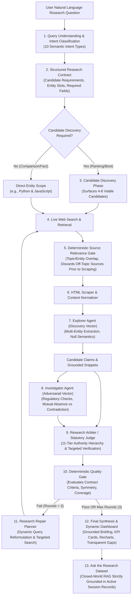

# ResearchLens AI

**Multi-Agent Research & Evidence Intelligence Platform**

Developed by **Nishant Choudhary**

---

## 1. Overview & Core Philosophy

**ResearchLens AI** is an autonomous multi-agent research and evidence intelligence platform that transforms complex natural-language questions into rigorously validated, source-grounded insights. Rather than deploying conversational chatbots that summarize search results without verification, ResearchLens AI executes an adversarial, multi-stage multi-agent pipeline where specialized AI agents independently plan research strategies, discover candidates, evaluate source relevance, audit claims, detect substantive contradictions, and synthesize verified results.

### The Grounding Principle: Correctness Over Forced Completeness

The defining design principle of ResearchLens AI is:

> **"For any research question, ResearchLens AI must either produce a properly supported, source-grounded result OR explicitly explain which parts could not be verified. It must never fabricate an answer simply because the pipeline needs to complete."**

- **Missing values are represented as `null`**, never as pseudo-factual strings like `"Not disclosed in source"` or `"N/A"` marked as verified.
- **Missing values carry `confidenceScore: null`**, ensuring unverified data never inflates research confidence metrics.
- **Evidence Coverage $\neq$ Confidence $\neq$ Completeness**: A research session can be $98\%$ confident in 2 verified fields while maintaining $40\%$ overall evidence coverage.

---

## 2. End-to-End Self-Correcting Research Architecture



---

## 3. Key Upgrades & Architectural Pillars

### A. Query Understanding & Semantic Intent Classification
The Planner Agent analyzes user inquiries and classifies them into one of 10 canonical intents:
- `FACT_LOOKUP`: Targeted factual queries (e.g. *"When was Python 3.11 officially released?"*). Bypasses unnecessary candidate discovery.
- `COMPARISON`: Comparative evaluations (e.g. *"Compare Python and JavaScript for backend development"*). Enforces symmetrical research across all requested entities.
- `RANKING` / `RECOMMENDATION` / `DISCOVERY`: Evaluative queries (e.g. *"Find best college in Rajasthan for BTech"*). Triggers candidate discovery first.
- `EXPLORATORY_RESEARCH`, `FACT_CHECK`, `CURRENT_INFORMATION`, `POLICY_OR_REGULATORY`, `MULTI_ENTITY_ANALYSIS`.

### B. Candidate Discovery Phase
For ranking and recommendation inquiries, ResearchLens AI executes a dedicated Candidate Discovery phase to identify 4–8 plausible candidate entities from search results before evaluating detailed criteria. The system normalizes institutional names, eliminates duplicates, and refuses to prematurely commit to a single candidate.

### C. Deterministic Source Relevance Gate
Before any retrieved URL is scraped or provided to an agent, it must pass through the `validateSourceRelevance` layer. The relevance gate calculates:
- Query keyword overlap
- Entity mention overlap
- Topic domain compatibility
- Rejection reason logging (e.g., rejecting EV charging sources when researching college admissions)

Sources scoring below the threshold are dropped immediately, saving scraper bandwidth and guaranteeing zero off-topic hallucination.

### D. Strict Session Isolation & Cache Safety
Every research session generates a unique, cryptographically distinct `researchSessionId` (`research_<timestamp>_<uuid>`).
- All claims, sources, entities, conflicts, arbiter evaluations, and metrics belong exclusively to that session.
- Web search caching incorporates normalized query parameters (`q`, `count`), ensuring cross-session queries never contaminate fresh research.
- "Ask the Dataset" operates exclusively on the active session's in-memory records.

### E. 11-Tier Evidentiary Authority Hierarchy
When evaluating claims and adjudicating disputes, ResearchLens AI applies a contextual 11-tier statutory authority classification:
1. `GOVERNMENT_STATUTORY`: Official government gazettes, acts of parliament, national legislation.
2. `REGULATOR`: Statutory oversight bodies (e.g. NIRF, AICTE, UGC, RBI, SEC, BEE).
3. `PRIMARY_ENTITY`: Official domain of the subject entity (e.g. university official portal, corporate investor relations).
4. `ACADEMIC_PRIMARY`: Peer-reviewed research papers, primary datasets.
5. `ACADEMIC_SECONDARY`: Institutional meta-analyses, systematic surveys.
6. `REPUTABLE_PUBLICATION`: Major established newsrooms, leading technical journalism.
7. `INDUSTRY_SOURCE`: Audited industry benchmarks, trade association reports.
8. `SECONDARY_DIRECTORY`: Third-party aggregator portals (e.g. CollegeDunia, Shiksha).
9. `AGGREGATOR`: Community review platforms, forums.
10. `REFERENCE`: General knowledge wikis (e.g. Wikipedia).
11. `UNKNOWN`: Unattributed or unrecognized domains.

### F. Canonical Evidence Status Model
ResearchLens AI establishes a unified evidence status model shared identically across every view in the application:
- `VERIFIED`: Confirmed by authoritative primary or statutory sources with high corroboration.
- `SUPPORTED`: Substantiated by reliable secondary sources, but below the statutory threshold.
- `CONFLICTING`: Two or more substantive, contradictory factual claims remain unresolved.
- `INSUFFICIENT_EVIDENCE`: A search was conducted, but reliable evidence was not disclosed. Value is `null`, confidence is `null`.
- `MISSING`: A mandatory field required by the Research Contract has not yet been retrieved.
- `UNVERIFIED`: Extracted candidate claim that has not completed adversarial verification.

### G. Distinguishing Mutual Absence vs Genuine Contradiction
When the Explorer finds no information on an attribute (e.g. *"Tuition fee unavailable"*) and the Investigator confirms the absence (e.g. *"No official fee table in public gazette"*), ResearchLens AI classifies this as `NO_COMPARABLE_EVIDENCE` / `AGREEMENT_ON_ABSENCE`, **never as a conflict**. Real conflicts are declared only when opposing, substantive factual values contradict (e.g. $94\%$ placement vs $81\%$ placement).

### H. Deterministic Quality Gate & Research Repair Loop
Prior to Final Synthesis, the platform executes a deterministic Quality Gate:
1. Are all required comparison entities present?
2. Has candidate discovery satisfied the minimum candidate threshold ($\ge 3$)?
3. Have identical required fields been attempted across all entities?
4. Did accepted sources pass the relevance threshold?

If the Quality Gate fails, the **Research Repair Planner** dynamically reformulates targeted search queries to resolve specific missing fields or candidates. Repair rounds are strictly bounded ($\le 3$ iterations) to prevent infinite loops. If evidence remains missing after maximum rounds, the synthesis explicitly reports the unverified gaps.

---

## 4. Multi-Agent Team & Model Assignments

ResearchLens AI assigns specialized roles to Groq's high-speed inference engine (`openai/gpt-oss-120b`):

| Agent Role | Responsibility | Temperature | Primary Output |
| :--- | :--- | :--- | :--- |
| **Research Planner** | Intent classification, contract generation, query decomposition | `0.15` | `ResearchContract` |
| **Candidate Discovery** | Surfaces 4–8 viable candidates for ranking/discovery queries | `0.20` | `CandidateEntity[]` |
| **Explorer Agent** | Broad discovery vector, multi-entity claim extraction | `0.20` | `DiscoveredEntity[]` (Null-safe) |
| **Investigator Agent** | Adversarial verification, counter-evidence, regulatory audit | `0.15` | `CounterEvidence[]` |
| **Research Arbiter** | 11-tier statutory adjudication, targeted conflict searches | `0.10` | `ArbiterBatchOutput` |
| **Research Repair** | Dynamic query reformulation for Quality Gate failures | `0.20` | `ResearchRepairPlan` |
| **Final Synthesis** | Executive brief, KPI cards, Recharts spec, unverified gaps | `0.20` | `DashboardSpec` |
| **Ask the Dataset** | Closed-world question answering over in-memory dataset | `0.10` | `AskDatasetResponse` |

---

## 5. UI Views & Cross-Page Semantic Consistency

The frontend provides 7 specialized views, all deriving their numbers, badges, and statuses from one shared canonical state:

1. **Dashboard:** Executive briefing, 6 calibrated KPI cards (separating Confidence from Coverage), Recharts visualizations, dynamic evidence matrix with clickable source URLs, and CSV export.
2. **Evidence Inspector:** Deep-dive modal into individual claims with supporting verbatim snippets, authority badges, and verification rationale.
3. **Compare Agents:** Direct side-by-side audit of Explorer vs Investigator findings, displaying actual candidate claims and Arbiter decisions.
4. **Sources Intelligence:** Complete inventory of evaluated sources, filterable across all 11 authority categories, displaying domain, relevance score, and acceptance status.
5. **Provenance Graph:** Traceable chain of custody for every verified claim: $\text{Claim} \rightarrow \text{Evidence} \rightarrow \text{Source} \rightarrow \text{Agent} \rightarrow \text{Arbiter Resolution}$.
6. **Events Feed:** Real-time chronological audit trail of all pipeline actions, relevance rejections, arbiter decisions, and quality gate evaluations.
7. **Intelligence Pipeline:** Visual breakdown of the 11-stage NLP processing pipeline with truthful sequential vector descriptions and accurate file mappings.

---

## 6. Installation & Local Setup

### Prerequisites
- **Node.js**: v18.0.0 or higher (v20+ recommended)
- **npm** or **bun**
- **Groq Cloud API Key**: Obtain a free API key at [console.groq.com](https://console.groq.com)

### Quick Start

1. **Clone the repository:**
   ```bash
   git clone https://github.com/ni-saantt/Research_Lens_AI.git
   cd Research_Lens_AI
   ```

2. **Install dependencies:**
   ```bash
   npm install
   ```

3. **Configure environment:**
   Create a `.env.local` file in the project root:
   ```env
   GROQ_API_KEY=gsk_your_groq_api_key_here
   PORT=3000
   ```

4. **Start the development server:**
   ```bash
   npm run dev
   ```
   Open your browser and navigate to `http://localhost:3000`.

5. **Build for production:**
   ```bash
   npm run build
   ```

---

## 7. Technology Stack

- **Frontend:** React 19, TypeScript, Vite, TailwindCSS, Lucide Icons, Recharts, `@xyflow/react`.
- **Backend:** Node.js, Express, TypeScript (`tsx`), Server-Sent Events (SSE).
- **LLM Inference:** Groq Cloud SDK (`groq-sdk`), Meta Llama & OpenAI Flagship OSS Models.
- **Validation:** Zod schemas enforcing strict JSON outputs.
- **Web Retrieval & Crawling:** Cheerio HTML parser, DuckDuckGo Instant Search, Wikipedia OpenSearch API.

---

## 8. License

Developed by **Nishant Choudhary**. Distributed under the MIT License.
